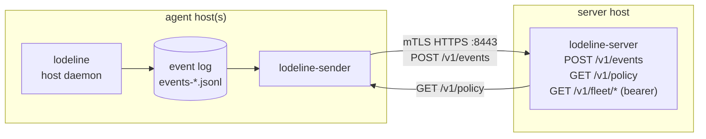

# lodeline-server — Install & Operations Guide (Linux)

`lodeline-server` is the OSS reference collector. It receives posture events from
agents over **mTLS HTTPS**, persists them as per-host JSONL, serves a **signed
policy bundle** at `GET /v1/policy`, and exposes a bearer-gated read API for
fleet queries. It measures and aggregates; it does not block.

This guide is an end-to-end **production** deployment on Linux. It is distinct
from the lab walkthrough in
[`deployment-2machine-test.html`](deployment-2machine-test.html), which sets up
a throwaway VM for testing. The macOS agent side is covered in
[install-macos-agent.md](install-macos-agent.md).

Validated on **Rocky Linux 9 / RHEL 9** (the maintainer's environment).
Debian/Ubuntu works via the `.deb` package; deltas are called out inline.

---

## 1. Topology & ports



- **Server inbound:** exactly **one** port, `8443/tcp` (the `bind` value), which
  all `/v1/*` routes share. When the enrollment listener is set (§3.2), add its
  port (`enroll_listener.bind`, for example `8444/tcp`), which serves only
  `POST /v1/enroll`.
- **Agent hosts inbound:** none. They only make **outbound** connections to
  `8443`, and to the enrollment port while they enroll. (Egress only, which
  suits locked-down endpoints.)

---

## 2. Install

Pick one. The `.rpm`/`.deb` path is recommended for servers — it ships a
hardened, disabled-by-default systemd unit and a config example.

### Option A — `.rpm` / `.deb` from Releases (RHEL / Rocky / Debian), recommended

Download the package for your distro from the
[latest release](https://github.com/Ju571nK/lodeline/releases/latest). These are
**static** builds, so they run on any glibc — including RHEL/Rocky 9:

```sh
# RHEL / Rocky / Fedora
sudo dnf install ./lodeline-server-*.x86_64.rpm

# Debian / Ubuntu
sudo apt install ./lodeline-server_*_amd64.deb
```

This installs `/usr/bin/lodeline-server`, the unit at
`/usr/lib/systemd/system/lodeline-server.service`, and
`/etc/lodeline/server.yaml.example`. The package depends on `openssl`, the
program enrollment signs with (§3.1), so the package manager installs it.

> Prefer to build the package yourself? `cargo install cargo-deb
> cargo-generate-rpm && packaging/build.sh server` produces them under
> `target/debian/` and `target/generate-rpm/`. A native (glibc) `.rpm` build
> also needs rpm's `find-requires` — install `rpm-build` on RHEL/Rocky first;
> `build.sh` stops with an error if it is missing.

You also need `lodeline-sign` (operator CLI) on a trusted workstation to produce
the signed policy bundle — install the `lodeline-signer` package or use `install.sh`.

### Option B — `install.sh` (binaries only)

```sh
curl --proto '=https' --tlsv1.2 -fsSL \
  https://raw.githubusercontent.com/Ju571nK/lodeline/main/install.sh | LODELINE_PROFILE=fleet sh
```

Installs the six release binaries (`lodeline`, `lodeline-sender`, `lodeline-server`,
`lodeline-sign`, `lodeline-mcp`, `lodeline-hook`) to `~/.local/bin`. You then wire up the
systemd unit and config by hand (sections 4–6).

### Option C — build from source

```sh
cargo build --release -p lodeline-server   # → target/release/lodeline-server
```

> **aarch64 (ARM) servers:** releases ship `aarch64` RPMs and `arm64` debs
> alongside the x86_64 ones, so an ARM server can use the packages above.

---

## 3. PKI / mTLS

mTLS is **on** only when all three TLS fields are set in `server.yaml`. With any
of them missing the server runs **plain HTTP** (a startup WARN says so) — never
do that off localhost.

You need: a CA, a **server cert** whose SAN matches the address agents will
connect to, and a **client CA** that signs each host's client cert. A single
self-managed CA can play both roles. The one change that matters in production
is the **`subjectAltName`**.

```sh
cd /etc/lodeline   # or wherever you keep PKI material

# 1. CA
openssl req -x509 -newkey rsa:2048 -nodes -days 3650 \
  -keyout ca.key -out ca.crt -subj "/CN=lodeline-ca" \
  -addext "basicConstraints=critical,CA:TRUE" \
  -addext "keyUsage=critical,keyCertSign,cRLSign"

# 2. Server cert — SAN MUST contain the exact host/IP agents dial.
cat > server.ext <<'EOF'
basicConstraints = CA:FALSE
keyUsage = critical, digitalSignature, keyEncipherment
extendedKeyUsage = serverAuth
# Use the DNS name agents resolve, OR the literal IP if they dial by address:
subjectAltName = DNS:lodeline.example.com
# subjectAltName = IP:192.0.2.50
EOF
openssl req -new -newkey rsa:2048 -nodes -keyout server.key -out server.csr \
  -subj "/CN=lodeline.example.com"
openssl x509 -req -in server.csr -CA ca.crt -CAkey ca.key -CAcreateserial \
  -days 825 -extfile server.ext -out server.crt

# 3. Per-host client cert (repeat per agent host).
cat > client.ext <<'EOF'
basicConstraints = CA:FALSE
keyUsage = critical, digitalSignature
extendedKeyUsage = clientAuth
EOF
openssl req -new -newkey rsa:2048 -nodes -keyout client-hostA.key -out client-hostA.csr \
  -subj "/CN=hostA"
openssl x509 -req -in client-hostA.csr -CA ca.crt -CAkey ca.key -CAcreateserial \
  -days 825 -extfile client.ext -out client-hostA.crt

rm -f *.csr *.ext ca.srl
```

Ship `ca.crt` + the host's `client-hostA.{crt,key}` to that agent host (the
sender's `server_ca_path` / `client_cert_path` / `client_key_path`). Keep
`ca.key` offline/secured.

> **SAN is the #1 mTLS gotcha.** If agents dial `https://192.0.2.50:8443` but
> the cert SAN only has a DNS name, the TLS handshake fails. Put the literal
> `IP:` in the SAN, or give agents a resolvable DNS name.

### 3.1 Automated enrollment (B-mint) — optional

Instead of hand-running `openssl` per host (§3 step 3), the server can mint a
host's client cert from a CSR, gated by a single-use, TTL, per-host token. A PMS
(Ansible/Intune) — already enrolled — calls the endpoint on a new host's behalf
and stages the bundle. Enrollment is **off** unless configured, and the server
**refuses to enable it without mTLS** (no cleartext cert minting).

**1. Issue an intermediate CA from your offline root** (the server only ever
holds the intermediate; the root key stays offline):

```sh
openssl req -new -newkey rsa:2048 -nodes -keyout int.key -out int.csr -subj "/CN=lodeline-enroll-intermediate"
openssl x509 -req -in int.csr -CA ca.crt -CAkey ca.key -CAcreateserial -days 1825 \
  -extfile <(printf "basicConstraints=critical,CA:TRUE,pathlen:0\nkeyUsage=critical,keyCertSign,cRLSign") -out int.crt
sudo install -m600 int.key /etc/lodeline/enroll-int.key
sudo install -m644 int.crt /etc/lodeline/enroll-int.crt
```

**2. Configure `server.yaml`** (requires a configured `host_allowlist_path` and
the mTLS triple — both are enforced at boot, else enrollment stays off):

```yaml
enroll_ca_cert_path: "/etc/lodeline/enroll-int.crt"
enroll_ca_key_path:  "/etc/lodeline/enroll-int.key"   # 0600 or enrollment disables
enroll_tokens_path:  "/var/lib/lodeline-server/enroll-tokens.json"
enroll_cert_days: 30                                # short — re-enroll is the revocation story
host_allowlist_path: "/var/lib/lodeline-server/host-allowlist.json"   # REQUIRED (restrictive set)
```

The server rewrites the allowlist each time a host enrolls, so the path must sit
in a directory the service can write. The unit makes only
`/var/lib/lodeline-server` and `/var/log/lodeline-server` writable, so keep the
file in the first. Create it before you start the server:

```sh
sudo install -d -o lodeline -g lodeline -m 0750 /var/lib/lodeline-server
echo '{"hosts":[]}' | sudo -u lodeline tee /var/lib/lodeline-server/host-allowlist.json
sudo restorecon -R /var/lib/lodeline-server   # SELinux hosts (Rocky/RHEL) only
```

Without the `restorecon`, SELinux keeps the generic `var_lib_t` label on the new
directory and the server cannot read the file.

The server validates the intermediate at boot (CA:TRUE, key⇄cert match, 0600),
that it can run `openssl`, and that it can write next to the allowlist. A failed
check logs an `enroll:` line naming the cause, and enrollment stays off. Signing
puts its temporary files in `/var/lib/lodeline-server`, in short-lived
`lodeline-enroll-*` directories that are removed when signing ends.

An allowlist that sat at `/etc/lodeline/host-allowlist.json` cannot be rewritten
by the unit, so every enrollment failed after it spent the token. Move the file
to `/var/lib/lodeline-server/`, set `host_allowlist_path` to the new path, and
restart the server.

**3. Issue a token** (server host; prints the plaintext once — only its hash is
stored). Run it as the service account:

```sh
sudo -u lodeline lodeline-server enroll-token --config /etc/lodeline/server.yaml --host-id <agent-host_id> --ttl 1h
#  → enrollment token: <opaque> (give this to the PMS for that host)
#  To issue it before the agent has run, set the host's id with `lodeline init-host-id` (§9).
```

The command replaces the token file and creates `<enroll_tokens_path>.lock`, both
owned by the user that runs it and mode 0600. After a run as root the server,
which runs as `lodeline`, can open neither, and every enrollment answers
`500 sign_failed` until you give both files back to `lodeline` (§10).

**4. Enroll.** On the new host, make its private key and a CSR with
`CN=<host_id>`. `lodeline-sender csr` needs no `openssl` binary, so it also works on
Windows. It writes an ECDSA P-256 key (mode 0600 on unix) and refuses to replace a
file that exists:

```sh
lodeline-sender csr --host-id <host_id> --key-out /etc/lodeline/client.key --csr-out host.csr
# Alternative where openssl is installed:
# openssl req -new -newkey rsa:2048 -nodes -keyout host.key -out host.csr -subj "/CN=<host_id>"
```

The key stays on the host. The PMS then sends the CSR to the endpoint over mTLS:

```sh
curl --cert pms.crt --key pms.key --cacert ca.crt \
  -X POST https://lodeline.example.com:8443/v1/enroll \
  -H 'content-type: application/json' \
  -d "{\"token\":\"<opaque>\",\"host_id\":\"<host_id>\",\"csr_pem\":\"$(awk '{printf "%s\\n",$0}' host.csr)\"}"
#  → {"client_cert_pem":"...", "ca_chain_pem":"...", "host_id":"...", "not_after":"...", "serial":"..."}
```

The server signs with a **fixed client-cert profile** (`CA:FALSE`, `clientAuth`,
`subjectAltName=DNS:<host_id>`), re-inspects the issued cert, adds the host to
the allowlist, and writes a signed line to `enrollment-audit.jsonl`. On the host,
write `client_cert_pem` followed by `ca_chain_pem` to the sender's
`client_cert_path`, and use the key from the first command as `client_key_path`
(§7). When `client_ca_path` holds only the root, a file with the leaf alone fails
the TLS handshake. Tokens are single-use; a failed mint spends the token (issue
a fresh one). Every token failure returns a generic `403 enrollment_denied`.

> Enrollment **mints** certs (Part B). Read-only **artifact** serving (Part A,
> §5.1) is separate. To bind each host's certificate to its host_id on
> `POST /v1/events`, set `events_require_cert_host_match: true`; certificates
> from `/v1/enroll` already match. The server has no CRL or OCSP revocation, and
> it does not attest that a key was made on the host. Short certificate
> lifetimes stand in for revocation.

### 3.2 Enrollment listener (self-enrollment), optional

A host that has no client certificate cannot reach `/v1/enroll` on the main
port, because that port asks every client for one. The enrollment listener is a
second TLS port for this case. It presents the main server certificate
(`tls_cert_path`, `tls_key_path`), asks for no client certificate, and serves
only `POST /v1/enroll`. The token in the request is the credential. Both ports
share one token file, one audit chain and one allowlist, so a token works once,
on either port. It is off unless `enroll_listener` is set.

**1. Configure `server.yaml`** on top of §3.1 and the mTLS triple:

```yaml
enroll_listener:
  bind: "0.0.0.0:8444"
events_require_cert_host_match: true
```

The server refuses to start when:

- `enroll_listener` is set without `tls_cert_path`, `tls_key_path` and
  `client_ca_path`.
- `enroll_issuer_fingerprints` is set too, even as an empty list. The listener
  takes no client certificate, so the issuer gate would deny every caller. Where
  you need the issuer gate (#211), keep the listener off and enroll through the
  main port (§3.1).
- `enroll_listener.bind` equals `bind`.
- `events_require_cert_host_match` is not `true`. Without it, any fleet
  certificate can post events as any host, so one leaked token would give a
  certificate that speaks for the whole fleet. Certificates from `/v1/enroll`
  already match. Reissue hand-made certificates whose CN is not the host_id
  (§3 step 3) before you set it.
- Enrollment is off, because a §3.1 check failed. The `enroll:` warning above
  the error names the check.

The server binds both ports before it serves either and logs one
`starting lodeline-server (mTLS)` line with `bind` and `enroll_bind`. If either
listener stops, the process exits non-zero and systemd restarts it.

**2. Probe it** from a host, with the CA and no client certificate. A made-up
token answers 403, which shows that the port, the server certificate and the
token check work:

```sh
curl --cacert ca.crt -X POST https://lodeline.example.com:8444/v1/enroll \
  -H 'content-type: application/json' \
  -d '{"token":"x","host_id":"00000000-0000-4000-8000-000000000000","csr_pem":"x"}'
#  → {"error":{"code":"enrollment_denied","message":"enrollment denied"}}  (HTTP 403)
```

**3. Enroll** with the request from §3.1 step 4, sent to the enrollment port
with no `--cert` or `--key`. Then install the certificate as in §3.1.

| Answer | Meaning |
|---|---|
| 200 | The certificate was issued and the host is on the allowlist. |
| 400 or 422 | The request is malformed. |
| 403 `enrollment_denied` | The token is unknown, spent, expired or for another host_id, or the CSR CN is not the host_id. Retrying does not help; issue a new token. |
| 413 | The body is over 17 KiB (the CSR limit is 16 KiB). |
| 415 | The request has no `content-type: application/json`. |
| 421 | A second request on one connection. Send each request on a new connection. |
| 500 | A server fault. The token may be spent: read the server log, then issue a new token. |
| 503 `busy`, `Retry-After: 1` | Another enrollment is running. Retry after a second. |
| Connection closed before the TLS handshake | The source's rate limit, or the listener is full. curl exits 35 with `Connection reset by peer` or `SSL_ERROR_SYSCALL`. Wait about a minute, then retry. |

**Limits.** They are fixed, not configured:

- Per source address: 10 connections, then 1 every 6 s. IPv6 sources in one
  /64 share a count.
- One request per connection, on HTTP/1.1 and HTTP/2.
- At most 64 connections at once on the port.
- A connection closes 15 s after it is accepted, unless its request is being
  processed. Then it closes once the answer is written.
- A body of at most 17 KiB.

**What is logged.** Only the request that redeems a token writes to
`enrollment-audit.jsonl`: an `issued` line, or `denied` with reason
`sign_failed` when signing fails after the token is reserved. The port cannot
grow the chain beyond one line per token you issue. Every other denial on this
port, the rate limit included, logs a warning `enroll request refused` with
`reason` and `source`. Each reason logs at once the first time. Later ones in
the next minute are only counted, and the count (`suppressed`) appears on the
next line for that reason after the minute. The `enroll: issued client cert`
line carries the host's `peer` address. These lines show by default.
`RUST_LOG` changes the level (§7).

**Exposure.** Open the port only to the networks hosts enroll from (§6). Put
no load balancer or TLS proxy in front of it. The limits count TCP source
addresses, so a balancer would put every host in one count, and a TLS proxy
would show hosts its own certificate instead of the server's. The limits stop
one source, not many. A flood from many addresses can stop enrollment, but not
the main port, so filter it at the firewall.

---

## 4. Signed policy bundle

The server serves a **signed** policy at `/v1/policy`; agents verify the
signature against their keystore before applying. Produce it with `lodeline-sign`
on a trusted workstation (never on the server with the live key):

```sh
lodeline-sign keygen --id prod-key-1 --out signing-key.json     # ed25519 keypair
lodeline-sign sign \
  --in policy.yaml \
  --key signing-key.json \
  --policy-version 2 \
  --valid-until 2027-01-01T00:00:00Z \
  --out signed-policy.json
```

Copy `signed-policy.json` to the server's `policy_bundle_path` (section 5). The
**public** half goes into each agent's keystore — see
[install-macos-agent.md § keystore](install-macos-agent.md). Keep `signing-key.json` offline.

> `--policy-version` must be **greater than** the version the agents last applied,
> or they refuse it with `version_regression`. An agent that has only a local
> `policy.yaml` accepts version `1`. An agent from v0.12.0 or earlier does not: it
> records its local file as version 1, so start at `2` if any of those remain.

On a packaged or root agent, the applied policy lands in
`/var/lib/lodeline/applied/policy.yaml`, and a bundle in `rule-packs.yaml` beside it.
Each replaces the content of its namesake in `/etc/lodeline`, which an apply does not
write, so a hand edit there has no effect while the applied file exists. `lodeline show
paths` prints the file in force. To go back to the local file, delete the applied one
and run `sudo lodeline reload`. The next signed version replaces it again.
After that, `lodeline status` still reports the signed version and its expiry while the
local file runs, and only a higher version lands. If `/etc/lodeline` has no
`policy.yaml`, deleting the applied one keeps the previous policy with one warning in the
log. A `policy.yaml` that returns loads within about 5 seconds, even if it is still being
saved, and a restart loads the defaults.

---

## 5. Configure `server.yaml`

Copy the example and edit. Full field reference:

```yaml
# /etc/lodeline/server.yaml
bind: "0.0.0.0:8443"                                   # all interfaces; 127.0.0.1 if behind a proxy
events_out_dir: "/var/lib/lodeline-server/events"         # per-host date-rotated JSONL
policy_bundle_path: "/var/lib/lodeline-server/signed-policy.json"

# mTLS — all three or none:
tls_cert_path: "/etc/lodeline/server.crt"
tls_key_path:  "/etc/lodeline/server.key"
client_ca_path: "/etc/lodeline/ca.crt"

# Optional hardening:
# host_allowlist_path: "/var/lib/lodeline-server/host-allowlist.json"  # {"hosts":["uuid",...]}
# high_water_path: "/var/lib/lodeline-server/high_water.json" # at-least-once dedup

# Optional — serve signed agent artifacts for air-gapped / PMS install (§5.1):
# artifacts_dir: "/var/lib/lodeline-server/artifacts"
```

### Read API token

The fleet/read endpoints (`/v1/meta`, `/v1/fleet/*`, `/v1/events`, …) are gated
by a bearer token from the **`LODELINE_SERVER_READ_TOKEN`** environment variable.
If it is unset, those routes return **404** (the data plane and `/v1/healthz`
still work). Set it via a systemd drop-in so it isn't in the world-readable
config:

```sh
sudo systemctl edit lodeline-server
# [Service]
# Environment=LODELINE_SERVER_READ_TOKEN=<long-random-token>
```

The `lodeline-manager` web console reads the fleet through these routes with the
same token. Each release has a `lodeline-manager-<version>-<target>` archive of it. To
install and run it, see [`apps/manager/README.md`](../apps/manager/README.md).

### 5.1 Serve agent artifacts (air-gapped / PMS install)

Set `artifacts_dir` and the server serves the signed release files read-only, so
an air-gapped fleet or a PMS (Ansible/Intune) can pull binaries from the server
it already runs instead of GitHub. Absent ⇒ the routes 404 (feature off).

Populate the directory from a release (the operator does this once per version):

```sh
sudo mkdir -p /var/lib/lodeline-server/artifacts
# copy the GitHub release assets you intend to serve, e.g.:
#   lodeline-<ver>-<target>.tar.gz / .zip, lodeline*_<ver>*.deb / .rpm,
#   SHA256SUMS, build-manifest.json
```

Two routes, both gated by the **read token** (`LODELINE_SERVER_READ_TOKEN`) like the
rest of the read API:

```sh
curl -H "Authorization: Bearer $TOKEN" https://lodeline.example:8443/v1/artifacts
#   → {"artifacts":["SHA256SUMS","build-manifest.json","lodeline-…-musl.tar.gz", …]}
curl -H "Authorization: Bearer $TOKEN" \
  https://lodeline.example:8443/v1/artifacts/lodeline-0.6.2-aarch64-unknown-linux-musl.tar.gz -O
```

The one-line installer can target the server directly — it verifies the same
`SHA256SUMS`, so the trust story is unchanged:

```sh
LODELINE_VERSION=v0.6.2 \
LODELINE_BASE_URL=https://lodeline.example:8443/v1/artifacts \
LODELINE_BASE_TOKEN=$TOKEN \
  sh -c "$(curl -fsSL https://raw.githubusercontent.com/Ju571nK/lodeline/main/install.sh)"
```

> The artifact files stay **operator-populated and signed**; the server only
> serves them read-only. Filenames are whitelisted (no path traversal). Per-host
> certificate enrollment is a separate concern (not this endpoint).

---

## 6. Firewall & SELinux (Rocky / RHEL)

```sh
sudo firewall-cmd --add-port=8443/tcp --permanent && sudo firewall-cmd --reload
```

Ubuntu: `sudo ufw allow 8443/tcp`.

With the enrollment listener (§3.2), open its port only to the networks hosts
enroll from, for example `192.0.2.0/24`:

```sh
sudo firewall-cmd --permanent --add-rich-rule='rule family="ipv4" source address="192.0.2.0/24" port port="8444" protocol="tcp" accept'
sudo firewall-cmd --reload
# Ubuntu: sudo ufw allow from 192.0.2.0/24 to any port 8444 proto tcp
```

`lodeline_server_t` can bind an unreserved port. If `semanage port -l` lists a
label for the enrollment port, relabel it as `packaging/selinux/README.md`
describes.

Enrollment runs `openssl` as the server's own process. The package's SELinux
module lets `lodeline_server_t` run it. If a host loaded an older module, or
none, update it as `packaging/selinux/README.md` describes, or enrollment stays off.

SELinux is **Enforcing** on Rocky/RHEL by default. The package's
`StateDirectory`/`LogsDirectory` (`/var/lib/lodeline-server`, `/var/log/lodeline-server`)
get correct contexts automatically. If you point `events_out_dir` somewhere
custom, label it: `sudo semanage fcontext -a -t var_lib_t "/your/path(/.*)?" &&
sudo restorecon -Rv /your/path`.

---

## 7. Run

```sh
# Package install:
sudo cp /etc/lodeline/server.yaml.example /etc/lodeline/server.yaml
sudo $EDITOR /etc/lodeline/server.yaml
sudo systemctl enable --now lodeline-server
journalctl -u lodeline-server -f          # watch startup; confirm "mTLS" not "plain HTTP"

# Manual (source/install.sh):
LODELINE_SERVER_READ_TOKEN=<token> lodeline-server serve --config /etc/lodeline/server.yaml
```

The unit runs as `root` with `ProtectSystem=strict` and writes only to its
state/log dirs. See [`packaging/README.md`](../packaging/README.md) for the unit
details.

`lodeline-server` and `lodeline-sender` log at `info` by default and write their logs
to stderr, which the journal keeps. `RUST_LOG` sets
the level of each one, for example `RUST_LOG=warn` for less output or
`RUST_LOG=debug` for more. For a package install, set it in a drop-in with
`sudo systemctl edit lodeline-server` (or `lodeline-sender`):

```ini
[Service]
Environment=RUST_LOG=warn
```

---

## 8. Verify

```sh
# mTLS reachability (no token needed for healthz):
curl --cacert ca.crt --cert client-hostA.crt --key client-hostA.key \
  https://lodeline.example.com:8443/v1/healthz                       # {"status":"ok"}

# Read API (token required):
curl -H "Authorization: Bearer <token>" \
  --cacert ca.crt --cert client-hostA.crt --key client-hostA.key \
  https://lodeline.example.com:8443/v1/fleet/hosts

# Without the bearer token → 401 (proves the gate works):
curl --cacert ca.crt --cert client-hostA.crt --key client-hostA.key \
  https://lodeline.example.com:8443/v1/fleet/hosts                   # 401
```

Once an agent+sender are pointed here, events land under
`<events_out_dir>/<host_id>/…jsonl` and the host appears in `/v1/fleet/hosts`.
Beside each `received-YYYY-MM-DD.jsonl`, the server writes a hidden
`.received-YYYY-MM-DD.jsonl.recv` file with the time it received each batch.
A glob such as `received-*.jsonl` does not match the hidden file. The server
uses it to rebuild host status after a restart (#442). When you archive or
delete old event files, treat the two files of a day together.

---

## 9. Connect agents

For each agent host: issue a client cert (section 3), then configure that host's
**sender** ([install-macos-agent.md § ship to a server](install-macos-agent.md)).
Two alignment rules from the field:

1. **`host_id` must match.** The sender's `host_id` (or `LODELINE_HOST_ID`) must
   equal that host's agent `host_id` (the UUID in the agent's `state.db`). A
   mismatch makes the server reject the **whole batch** with
   `host_id_payload_mismatch`. Find the agent's id in its startup log:
   `journalctl -u lodeline | grep "agent host_id resolved"`.

   To choose the id yourself, for example to issue the host's token (§3.1)
   before the agent runs, run `lodeline init-host-id <uuid>` on the host before
   its first `lodeline run`. Run it as the account the agent runs as (root for the
   Linux packages), and pass the same `--state-db` as `lodeline run` if the agent
   uses one. The UUID must be a lowercase, hyphenated version 4 UUID. The command
   stores it exactly as given and writes only when the host has no host_id yet.
   It exits 0 when the host has that id, 3 when the host already has another one
   (it names that id and writes nothing), 2 for a malformed UUID, and 1 for any
   other error.
2. **One client cert per host**, all signed by `client_ca_path`.

---

## 10. Operations & troubleshooting

Operational notes (paths, signals, log levels): [runbook/operations.md](runbook/operations.md).
`RUST_LOG` sets the log level of the server and the sender. Both default to `info` and write to stderr, which the journal keeps (§7).
SIEM rules: [runbook/siem-rules.md](runbook/siem-rules.md).

| Symptom | Cause | Fix |
|---|---|---|
| Startup logs "plain HTTP" / no mTLS | One of the 3 `tls_*` fields unset | Set all three |
| TLS handshake fails from agent | Server cert SAN ≠ dialed host/IP | Put `DNS:`/`IP:` in SAN (§3) |
| Server rejects all events, `host_id_payload_mismatch` | sender `host_id` ≠ agent `host_id` | Align them (§9) |
| Read endpoints return 404 | `LODELINE_SERVER_READ_TOKEN` unset | Set it (§5) |
| Read endpoints return 401 | Missing/wrong bearer token | Send `Authorization: Bearer <token>` |
| `No route to host` from agent | Firewall / port not open | Open `8443/tcp` (§6) |
| Server exits with `enroll_listener is set but enrollment is off` | A §3.1 enrollment check failed | Fix what the `enroll:` warning above it names (§3.2) |
| Server exits with `invalid config` naming `enroll_listener` | A §3.2 boot refusal | Do what the message says (§3.2) |
| Server logs `enroll: cannot write next to host_allowlist_path` and enrollment is off | The service cannot rewrite the allowlist, for example because it sits under `/etc/lodeline` | Move it to `/var/lib/lodeline-server/` and update `host_allowlist_path` (§3.1) |
| Server logs `enroll: cannot run openssl at <path>` and enrollment is off | `openssl` is missing, or the service may not run it (SELinux denial: `ausearch -m avc -ts recent`) | Install the `openssl` package. On SELinux hosts use the package's policy module, which allows it (§6) |
| Every enrollment answers 500 `token store error` | The token file or its `.lock` file is owned by root after a root `enroll-token` run | `sudo chown lodeline:lodeline <enroll_tokens_path> <enroll_tokens_path>.lock`, then run `enroll-token` with `sudo -u lodeline` (§3.1) |
| Enrollment port closes the connection before TLS | Rate limit or full listener | Wait about a minute. The server logs `enroll request refused` with `reason=rate_limited` or `listener_full` and the `source` (§3.2) |

---

*Server defaults, ports, and the mTLS field semantics in this guide are taken
from `config/server.example.yaml` and `packaging/systemd/lodeline-server.service`.*
